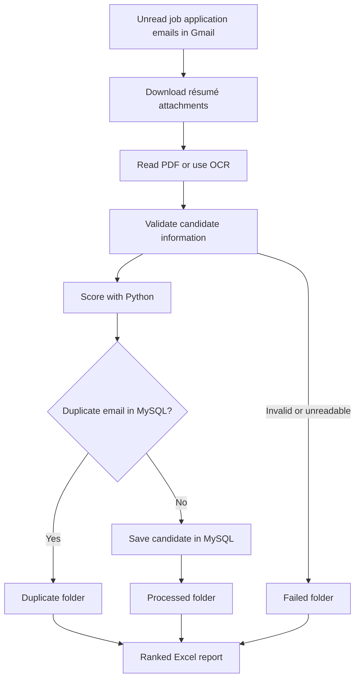

# ApplyPilot — Recruitment Process Automation

**ApplyPilot** is a UiPath-based recruitment automation project that helps process technical job applications. It collects applications from Gmail, extracts candidate information from digital or scanned résumés, scores candidates with Python, checks for duplicate applicants in MySQL, routes documents by status, and generates a ranked Excel report.

> **Project type:** Robotic Process Automation (RPA) · **Platform:** UiPath Studio (Windows)

## Demonstration

[Watch the ApplyPilot project demonstration](https://youtu.be/KqSb8rVNgWc)

## Workflow

1. **Collect — Gmail:** Find unread recruitment emails with attachments and download supported PDF, PNG, JPG and JPEG résumés.
2. **Read — PDF/OCR:** Extract text from digital PDFs, falling back to OCR for scanned PDFs and images. Identify candidate information and flag unreadable or incomplete files.
3. **Score — Python:** Pass candidate skills, education and experience to `Scripts/score_candidate.py`, which returns a score and High, Medium or Low priority.
4. **Store and route — MySQL and folders:** Check duplicate email addresses, save valid applicants, then route each résumé to `Processed`, `Duplicate` or `Failed`.
5. **Report — Excel:** Sort results by priority and score, then create a ranked candidate report.



## Technology stack

- **UiPath Studio:** Main workflow, Gmail and file automation, PDF/OCR, database activities, and Excel reporting
- **Python:** Rules-based candidate scoring (`score_candidate.py`), using Python standard libraries
- **MySQL:** Applicant records and duplicate checking; schema in `setup_applypilot_db.sql`
- **Gmail / Google Workspace:** Incoming application email collection
- **PDF extraction and OCR:** Text extraction from digital and image-based résumés
- **Excel:** Final ranked candidate results

## Repository layout

```text
ApplyPilot-RPA-Recruitment-Automation/
├── Main.xaml                  # UiPath entry workflow
├── project.json               # UiPath project definition and dependencies
├── entry-points.json          # Workflow entry points
├── Main.xaml.json             # UiPath workflow metadata
├── Scripts/
│   ├── score_candidate.py
│   └── setup_applypilot_db.sql
├── Input/                     # Local input staging (no real applicant data in Git)
├── Processed/                 # Locally generated outputs
├── Duplicate/
├── Failed/
├── Output/                    # Locally generated Excel reports
├── docs/                      # Project presentation and proposal
├── .gitignore
└── README.md
```

The folders used for processing are tracked with `.gitkeep` files; applicant résumés and generated reports should not be committed.

## Open ApplyPilot on another Windows laptop

1. Install **UiPath Studio** and sign in using an account with access to the required project resources.
2. Clone this repository with **GitHub Desktop**.
3. In UiPath Studio, choose **Open Local Project** and select `project.json` in the cloned folder.
4. Allow UiPath to restore the activity packages specified by `project.json`. Confirm that the project is compatible with your installed Studio version.
5. Install **Python** and update the project's `in_PythonExecutablePath` argument to point to `python.exe` on the new computer. The scoring script is at `Scripts/score_candidate.py`.
6. Install and configure **MySQL** and the compatible MySQL ODBC driver. Run `Scripts/setup_applypilot_db.sql` after reviewing its placeholder password, and set up the robot's credentials securely.
7. Reconnect **Google Workspace / Gmail** and confirm access to any required UiPath Integration Service connections and Orchestrator credential assets (including `ApplyPilot_MySQL_Credential`, if used in your environment).
8. Review file and folder paths, input arguments, permissions, and local directories. Supply sanitized sample résumés for testing.
9. Run a small test in UiPath Studio and verify the `Processed`, `Duplicate`, `Failed`, and `Output` results.

**Important:** Cloning restores the source files, **not** your UiPath installation, Gmail authorization, Orchestrator assets, local database contents, or Python/MySQL installations. Restore or recreate those separately. The database setup script creates the schema; it does not migrate applicant records.

## Configuration and privacy

- Keep this repository **private** while it includes coursework documents or potentially identifying information.
- Do **not** commit passwords, tokens, MySQL connection secrets, real applicant résumés, or generated reports containing applicant data.
- Use UiPath credential assets or another appropriate secret manager for credentials.
- The sample database setup script uses `CHANGE_THIS_PASSWORD` as a placeholder. Replace it with a secure password **locally**, not in Git.
- Check `.gitignore` before adding new generated folders or artifacts.

## Documents

See `docs/` for the project proposal and presentation. The presentation includes workflow screenshots, activities, and implementation explanations.

## Notes

This is a student project demonstrating an end-to-end recruitment workflow. The candidate score is a rules-based prioritization aid, **not** a hiring decision or a validated assessment of candidate suitability. Any real-world deployment would require additional privacy, fairness, accuracy, access-control, and operational review.
